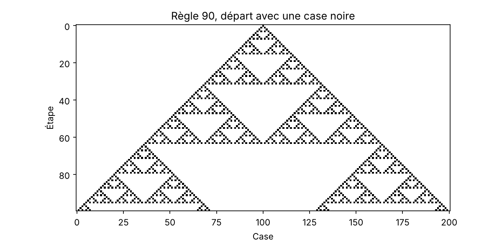
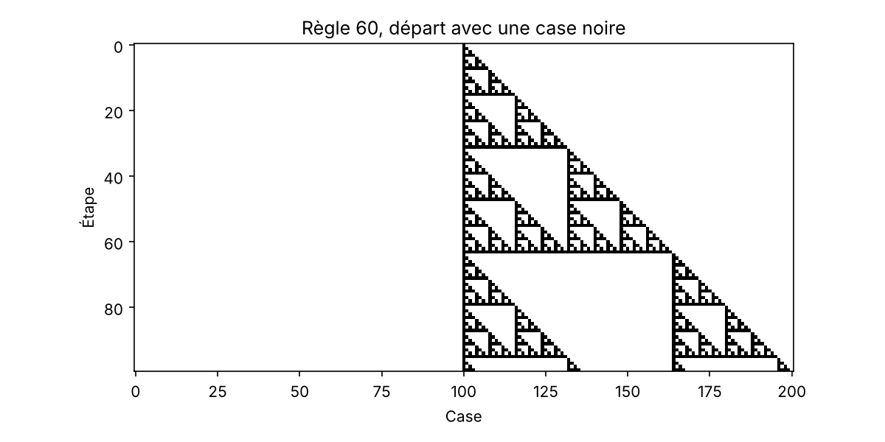
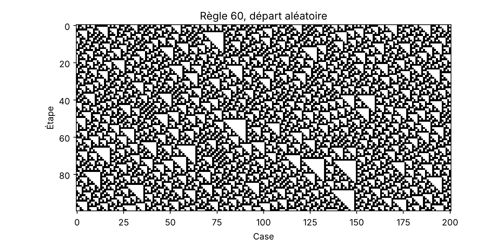
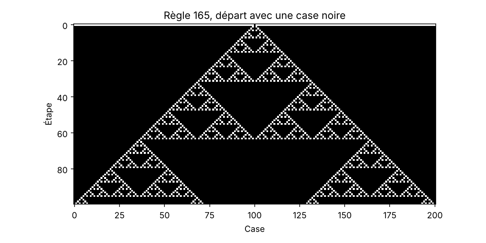
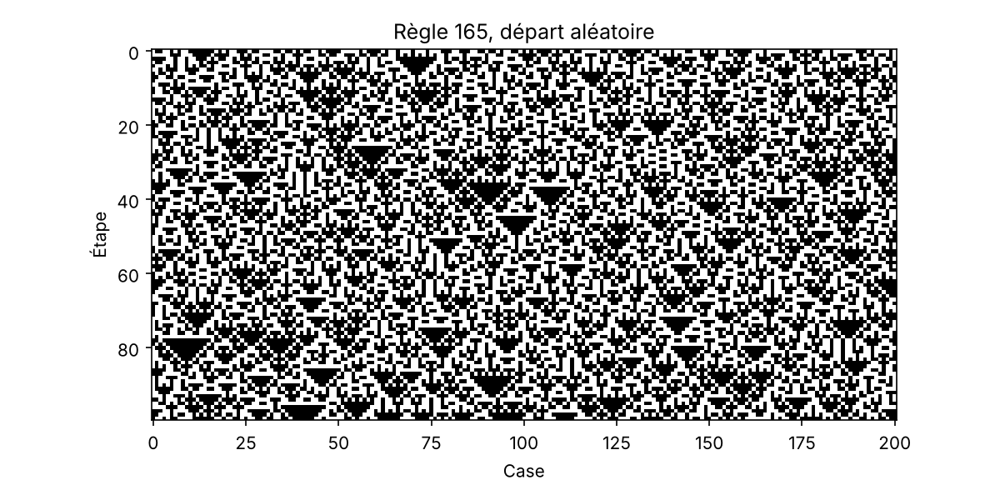
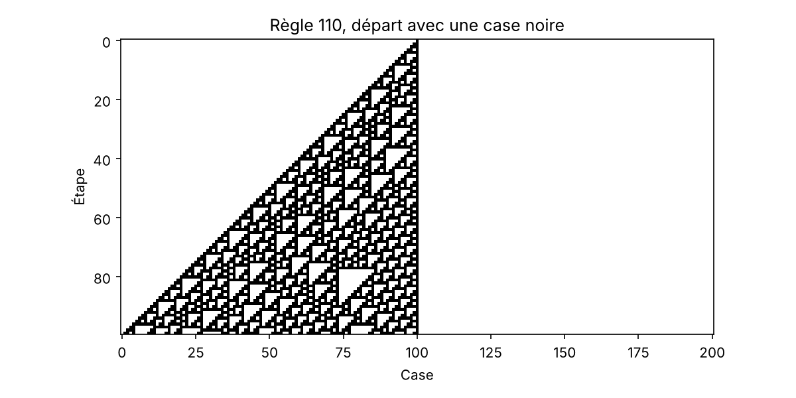
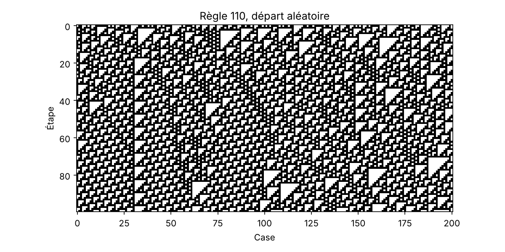

# Automates cellulaires élémentaires

Programmation et étude d'automates cellulaires à une dimension en Python : des règles très simples, où chaque case dépend seulement de ses voisines, qui produisent des motifs réguliers, fractals ou presque désordonnés.

> Projet réalisé par **Maud Sadrin** et **Evane Ohlmann**, présenté lors d'une restitution au CIRM (Centre International de Rencontres Mathématiques) le 21 février 2025.



---

## Le principe

On part d'une rangée de cases blanches (0) ou noires (1). À chaque étape, on calcule une nouvelle rangée : la couleur d'une case dépend uniquement de sa voisine de gauche, d'elle-même et de sa voisine de droite à l'étape précédente. En empilant les rangées, on obtient une image.

C'est l'équivalent d'une formule Excel recopiée ligne après ligne : dans la cellule B2, une formule qui ne regarde que les cellules juste au-dessus, par exemple `=SI(A1<>B1;1;0)`.

**Un exemple à la main** avec la règle 60 (« une case devient noire si la case au-dessus à gauche et celle juste au-dessus sont différentes »), à partir d'une seule case noire :

```
Étape 0 :  □ ■ □ □ □
Étape 1 :  □ ■ ■ □ □
Étape 2 :  □ ■ □ ■ □
Étape 3 :  □ ■ ■ ■ ■
```

En lisant les cases noires comme des 1, on retrouve le triangle de Pascal modulo 2. En continuant, le motif dessine un triangle de Sierpinski.

## Les règles étudiées

Avec deux états et un voisinage de trois cases, il existe 2⁸ = 256 règles, numérotées de 0 à 255 (classification de Wolfram).

| Règle | Ce qu'elle fait | Comportement |
|---|---|---|
| 60 (« règle d'Étienne ») | Noire si la case au-dessus à gauche et celle au-dessus diffèrent | Triangle de Sierpinski |
| 90 | Noire si les cases au-dessus à gauche et à droite diffèrent | Triangle de Sierpinski symétrique |
| 165 (« règle MCpL ») | Noire si les cases au-dessus à gauche et à droite sont identiques | Inverse de la règle 90 |
| 110 | Voir la table ci-dessous | Structures complexes |

**Table de la règle 110** :

| Gauche, milieu, droite | 111 | 110 | 101 | 100 | 011 | 010 | 001 | 000 |
|---|---|---|---|---|---|---|---|---|
| Nouvel état | 0 | 1 | 1 | 0 | 1 | 1 | 1 | 0 |

La règle 110 est **Turing-complète** (Matthew Cook, 2004) : malgré sa simplicité, elle peut en théorie réaliser n'importe quel calcul.

## Les résultats

| Règle | Départ avec une case noire | Départ aléatoire |
|---|---|---|
| 60 |  |  |
| 165 |  |  |
| 110 |  |  |

- **Des règles simples produisent des motifs complexes**, parfois fractals.
- **Le point de départ change tout** : la même règle donne un motif parfaitement régulier à partir d'une case, et presque désordonné à partir d'une ligne aléatoire.

## Le cadre théorique

Un automate cellulaire est une application F : A^ℤ → A^ℤ, où A est un ensemble fini d'états, telle qu'il existe un rayon r et une règle locale f vérifiant :

```
F(x)ₖ = f(xₖ₋ᵣ, …, xₖ₊ᵣ)
```

On munit les configurations de la distance d(x, y) = 2^(−min{|k| : xₖ ≠ yₖ}) : deux configurations sont proches si elles coïncident sur une grande zone autour du centre.

**Théorème de Curtis-Hedlund-Lyndon (1969)** : une application est un automate cellulaire si et seulement si elle est continue pour cette distance et commute avec le décalage. Autrement dit, un automate cellulaire est exactement une règle **locale** et **identique en tout point**.

## Le code

Le fichier `automates_cellulaires.py` contient :

- `regle_wolfram(numero)` : construit n'importe laquelle des 256 règles à partir de son numéro, en lisant son écriture binaire ;
- `automate(regle, ...)` : fait évoluer l'automate, avec une première ligne à une case noire ou aléatoire (graine fixée pour la reproductibilité) ;
- `afficher(grille, ...)` : affiche et enregistre l'image.

Choix de mise en œuvre :
- les états sont stockés en 0 et 1 dans un tableau `numpy`, les couleurs n'intervenant qu'à l'affichage ;
- chaque ligne est calculée d'un coup (calcul vectorisé) ;
- les bords sont **périodiques** : la première et la dernière case sont voisines, grâce à `np.roll` ;
- un test vérifie que la règle 60 reproduit bien le triangle de Pascal modulo 2.

## Reproduire les images

```bash
pip install -r requirements.txt
python automates_cellulaires.py
```

Les images sont enregistrées dans le dossier `images/`.

## Pistes d'extension

- Automates à **trois couleurs**, pour étudier la transmission d'information.
- Recherche de **motifs périodiques** et de structures invariantes.
- Questions de **réversibilité** : peut-on retrouver la ligne précédente à partir de la suivante ?
- Automates **à deux dimensions**, comme le jeu de la vie de Conway.

## Structure du dépôt

```
├── README.md
├── requirements.txt
├── automates_cellulaires.py
└── images/
    ├── regle_60_une_case.png
    ├── regle_60_aleatoire.png
    └── …
```
